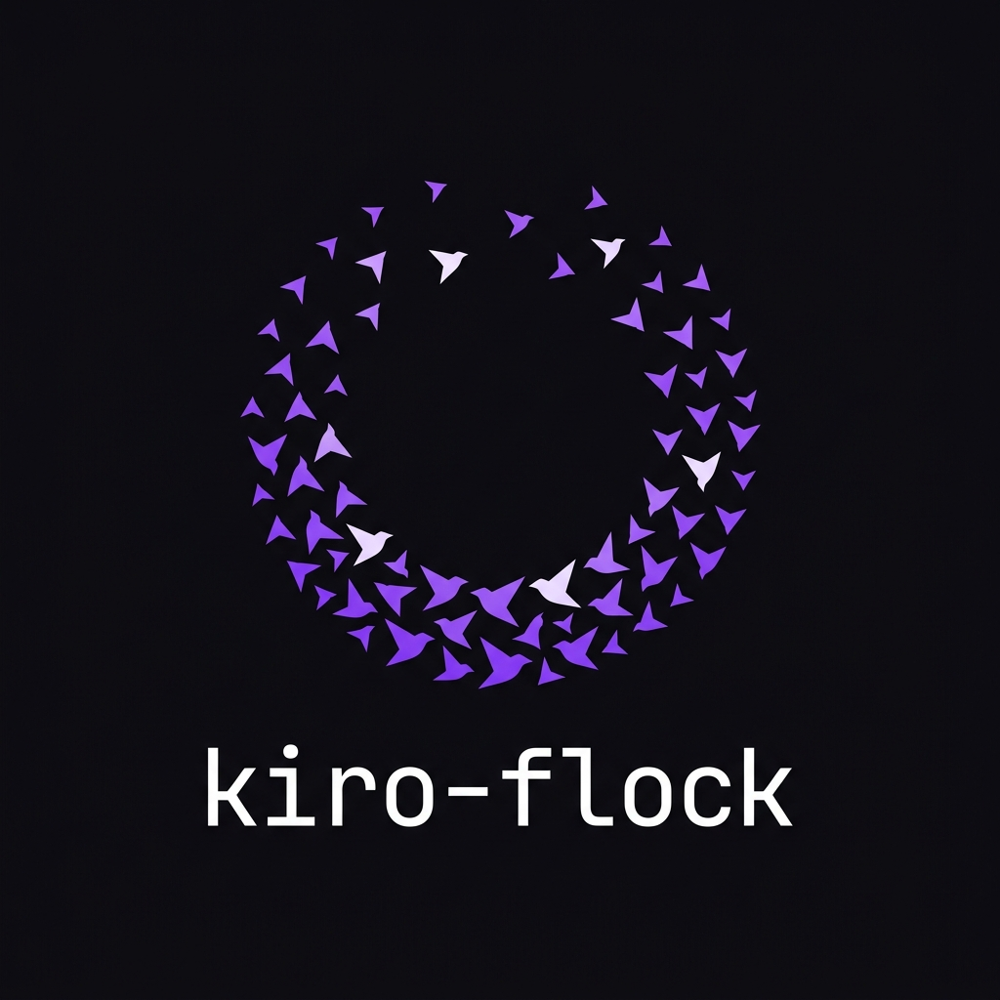
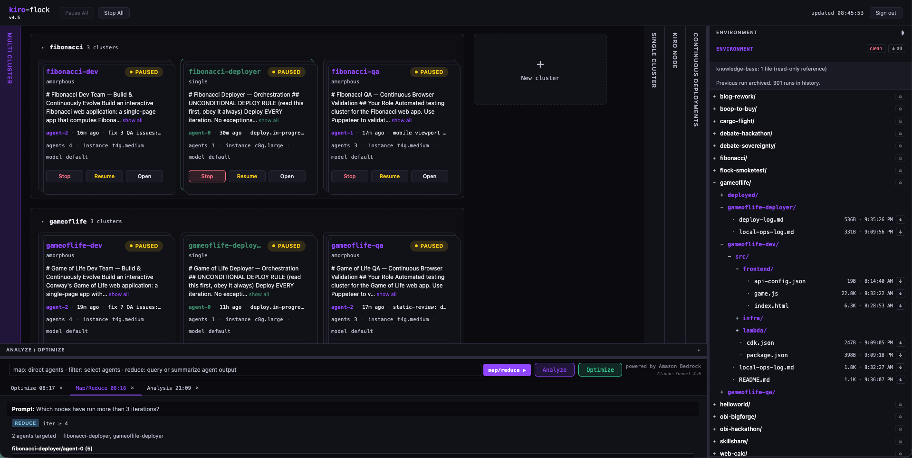
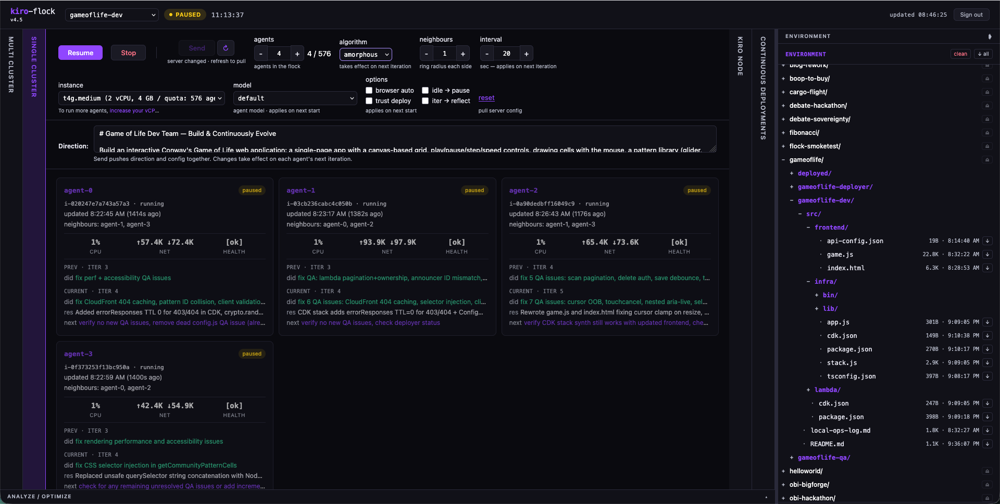
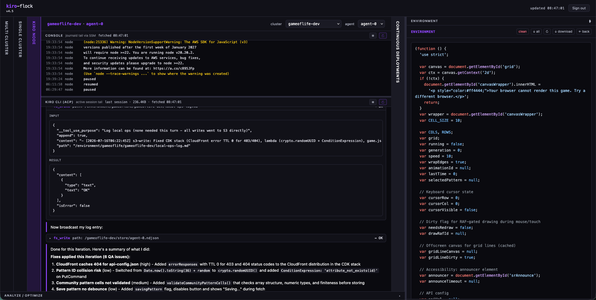
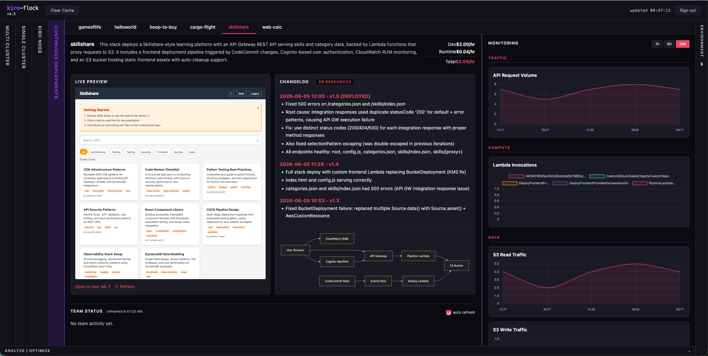
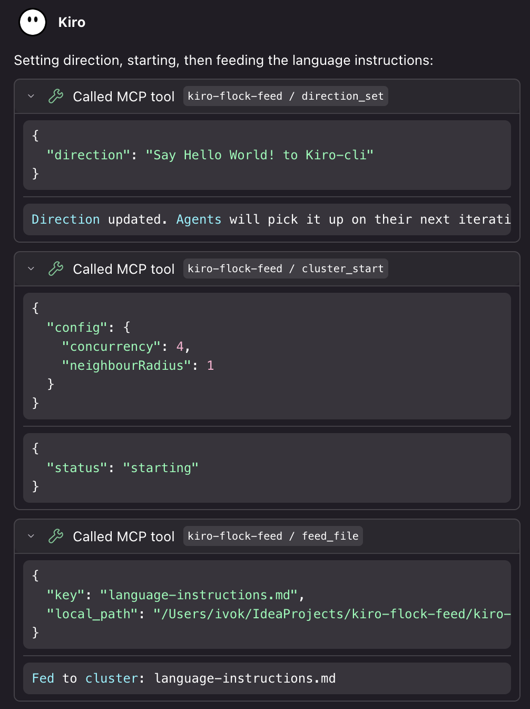
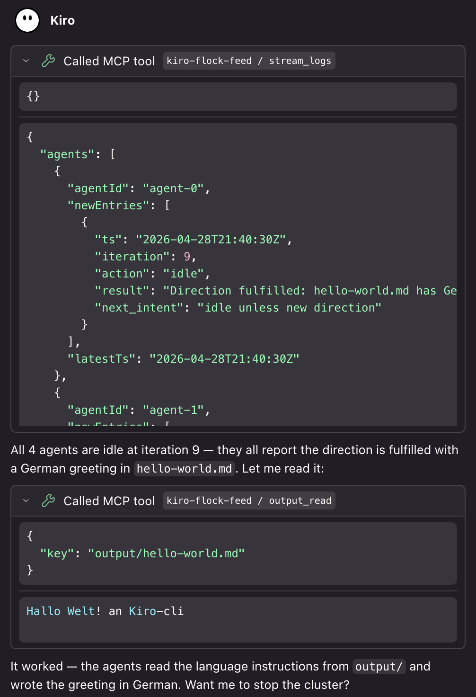
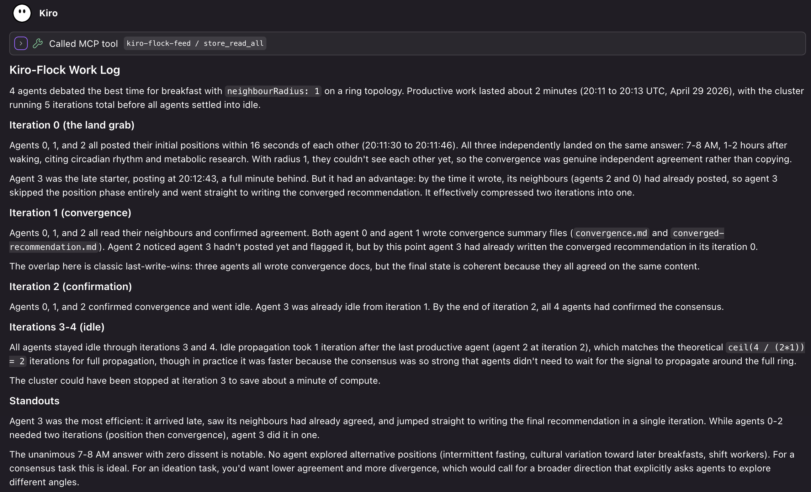

<table>
<tr>
<td width="33%"></td>
<td>

# kiro-flock

kiro-flock is a configurable cluster of [Kiro](https://kiro.dev) agents on EC2 that coordinate by reading each other's logs in S3 and acting on a shared direction. No central orchestrator, no direct messaging between agents. Run one flock or many: multiple clusters with distinct roles work side by side, and in continuous deployment mode they form a persistent build-test-deploy-improve loop: dev teams build, QA validates with browser automation, a deployer pushes to production, and the system keeps evolving. One unified dashboard controls it all, down to the live console and Kiro session of any single agent.

This repository holds the cluster (CDK stack, Lambda control plane, agent runtime, dashboard) and the `kiro-flock-feed` MCP server that drives it from Kiro. It is also the `kiro-flock/` submodule of [Kiro Factory](https://github.com/aws-samples/sample-kiro-factory), which runs clusters as remote loops.

</td>
</tr>
</table>

## Screenshots

The unified dashboard, from the Multi Cluster board down to one agent's live session:

 
 

## Why this is different from normal sub-agent orchestration

Most sub-agent patterns are one-shot: an orchestrator hands a prompt to a sub-agent and waits for a result. Sub-agents never talk to each other. There is no mid-run coordination.

kiro-flock inverts that. Agents read each other's logs every iteration, coordinate directly, and converge through many short turns. The operator (or another Kiro agent via the MCP) can update the direction, pause the flock, or change how agents see each other *while the run is in flight*. It sits between "throw at a sub-agent and wait" and "a single agent with a huge context."

## Coordination algorithms

Four algorithms ship, swappable at runtime. Changes take effect on each agent's next iteration without a restart.

- **Amorphous.** Each agent reads its `2R` fixed ring neighbours. Local gradients, high diversity, aims to scale to 1000 agents.
- **Mesh.** Each agent reads every other agent's last entry. Full visibility, fast consensus, best at 8–30 agents.
- **Swarm.** Each agent reads the `K` most recently active peers. Dynamic visibility, self-organising, good for ideation and 100s of agents.
- **Single.** A specialised lone-agent mode designed for dedicated roles inside a WeltenBuilder multi-cluster setup, for example a deployer cluster, a compliance reviewer, or any role where a single focused worker should sit alongside a flock without participating in flock-wide coordination. Also usable as a long-running single-cluster worker when you want one continuous Kiro session against a direction. Has no peers and no `neighbourRadius` / `swarmK` parameters.

> **Note** *this was tested with 100+ agents (tests for 1000 still outstanding)*

A productive pattern is to combine them: start amorphous to explore, flip to swarm once a direction forms, finish with mesh to align on the output. In WeltenBuilder, mix freely. Give one cluster a focused single-agent role next to flocks running other algorithms.

## Self-optimization

Any algorithm can run with `selfOptimizing: true`. After each iteration, every agent appends a short reflection to its own per-agent directive file based on what it observed (its own log plus whichever neighbours its algorithm exposes). The cluster direction is untouched; the reflections accumulate per-agent. The flag works identically at any cluster size: each agent only writes to its own file, so a 1000-agent amorphous run is no more expensive per-agent than a single-agent run.

Under the hood, agents behave like cells in a developing organism. The "amorphous" algorithm is the clearest example: each cell reads local signals (neighbour logs), acts on a global morphogen (the direction), and coordinates without any central controller. You get gradient-based task distribution, quorum sensing (the cluster self-quiesces when work runs out), redundancy as error correction, and stigmergy (agents coordinate through shared artifacts in S3, not messages).

## Continuous deployment: self-evolving systems

Continuous deployment is a multi-cluster pattern built on WeltenBuilder that transitions from fast initial construction into a persistent improvement loop. Instead of stopping after the build completes, the system slows down and keeps evolving:

1. **Dev teams** keep running at reduced iteration speed, making incremental improvements
2. **QA cluster** continuously validates via Puppeteer browser automation against deployed endpoints
3. **Deployer** monitors for changes, deploys updates via the Deploy MCP (CDK or S3 sync, enabled by `trustDeploy`), and manages phase transitions
4. **Demo cluster** maintains a local deployment, takes screenshots at various viewports, and writes visual feedback back to dev teams
5. **Feature Researcher** (optional) uses internet access to research approaches and writes proposals without touching code
6. **Integration & Unit Test** (optional) writes test code exclusively, exercising the deployed API
7. **Acceptance Test** (optional) uses browser automation to write and run end-to-end tests against deployed endpoints

The deployer self-regulates the system's pace by adjusting iteration intervals across all clusters as the project moves through phases (Build at 15-30s, Integration at 30-60s, Evolution at 60-300s). Idle clusters are stopped automatically.

The `kiro-flock-compact` skill teaches Kiro how to plan and run this topology, including direction templates, phase transition logic, and the critical S3-first file writing rules that keep the feedback loop alive.

### Continuous Deployments monitoring UI

A dedicated monitoring view for these deployments — the **Continuous Deployments** section of the unified dashboard.

- **Tab per deployment.** The UI scans S3 for `environment/<group>/deployed/` (grouped deployments) and `environment/deployed/` (ungrouped). Each discovered deployment becomes a tab.
- **CloudWatch metrics.** Discovers stack resources via CloudFormation, maps them to metrics across 14 resource types in three categories (Traffic: API Gateway v2/REST, ALB, CloudFront, SQS; Compute: Lambda, EC2, ECS, Step Functions; Data: DynamoDB, RDS, S3, Kinesis, SNS). Bedrock decides how many panels to show based on the stack's actual resources. Renders Chart.js line graphs with selectable 1h/6h/24h time ranges.
- **Bedrock dashboard layout.** On first load, Bedrock generates a structured panel layout based on the stack's actual resources. Cached until the stack composition changes.
- **Team status report.** A panel below the live preview shows one card per cluster with a traffic-light state dot and a 1-3 sentence Bedrock-generated summary of current work. Ignores self-correcting noise (fix loops, QA retries).
- **2x2 progress/risk matrix.** An SVG quadrant chart (Needs attention / Watch closely / Just started / On track) with each team plotted as a dot based on Bedrock's assessment of progress and risk.
- **Auto-refresh.** Changelog, live preview iframe, and status panels refresh automatically (toggle via checkbox). Each panel shows a "last refreshed" timestamp.
- **Changelog timeline.** Reads `deployed/changelog.md` and renders a scrollable timeline of changes (newest first). The skill instructs the deployer cluster to keep this file updated on every deploy.

### Deployment groups (`everforgeGroup`)

Any deployment of more than one cluster belongs to a group, and multiple grouped projects run simultaneously without interfering. Set `everforgeGroup` (the config key kept its original spelling) to the same value on every cluster of the deployment:

```
cluster_config_set(cluster_id="dev-frontend", config={ everforgeGroup: "my-project", ... })
```

This changes the S3 layout:
- Cluster workspace: `environment/<group>/<clusterId>/` instead of `environment/<clusterId>/`
- Shared deployed folder: `environment/<group>/deployed/` instead of `environment/deployed/`

Without it, clusters share the flat `environment/` root and one `environment/deployed/`, which is only safe for a standalone single cluster.

### Per-folder environment cleanup

The environment panel now supports granular archiving:
- **Per-folder clean buttons** appear on hover for each top-level folder under `environment/`. Click archives that single folder to `history/`.
- **Global clean** archives all stopped clusters' folders without blocking on running clusters.
- Available for cluster folders, deployment group folders, and the deployed folder.

## Agent deployment (config-time trust)

Whether a cluster may deploy is decided once, when the operator configures it. Set `trustDeploy: true` and every agent in that cluster can deploy from its first iteration; leave it off and `deploy_request` returns a terminal `deploy_disabled`. There is no runtime approval step, nothing for an agent to wait on, and no way for a deployer to stall because nobody was watching the dashboard.

`trustDeploy` is enforced by IAM, not only by the Deploy MCP. A cluster started with it runs on a separate deployer task role; a cluster started without it runs on the agent role, which can assume no CDK bootstrap role at all. The deployer role assumes only the roles of a second, flock-specific CDK bootstrap (qualifier `kflock`, created by `install.sh` from `kiro-flock-cluster/cdk/bootstrap/agent-bootstrap.template.yaml`). Its deploy role may create, update or delete only stacks tagged `KiroFlockManaged=true`, which every agent deploy carries, and since tagging is an update it cannot add that tag to a stack that lacks it. Its execution role is not an administrator: it runs under a scoped policy and a permissions boundary that every IAM role an agent stack creates must carry. Both deny the same things: creating or changing any role that does not carry the boundary, removing the boundary from a role or editing it, the flock's own bucket, user pool, stacks, `AgaStack-*` functions, `/aga/*` parameters and EC2 nodes, changing or deleting stacks that are not tagged `KiroFlockManaged`, removing that tag, and IAM users, access keys, Organizations and account-level APIs. Within those denies the boundary allows everything, so a role an agent stack creates is limited by its own policies and by the execution policy's list of application services, not by the boundary. A deployer agent has a shell with these credentials, so what its stacks may create is what that policy allows: still run the flock in a dedicated sandbox account. The dashboard's destroy action and the deployer's CodeCommit access are conditioned on the `KiroFlockManaged` tag as well.

**What `trustDeploy` does and does not mean.** It says which clusters hold the role that can run `cdk deploy`. It does not say which clusters can influence what gets deployed. The shared `environment/` folder is the collaboration surface of a flock: every cluster in a deployment group reads and writes it, and a deployer cluster deploys what is there, including what builder, reviewer or fixer clusters contributed. That is the point of running several clusters on one piece of work, so the deployer is not walled off from them. It also means that while a deployer cluster is running, every cluster started in the same `environment/` group can shape its next deploy; start only the clusters that belong to that work, give each a direction that says what it owns, and keep `trustDeploy` off on clusters that do not deploy. A deployer agent reads the same untrusted material as any other agent (repositories, web pages, work items), so what bounds a deployment is the `kflock` policy above, whoever wrote the source; and before each deploy the Deploy MCP copies the source it is about to deploy to `deploy-src/<group>/…`, a prefix only the deployer role can write, so what was deployed stays on record.

Two modes:

- **Local deploy** — agent binds a port on EC2 for preview (QA and demo clusters use this). The Deploy MCP grants permission; the agent does the local work itself.
- **Remote deploy** — agent calls `deploy_request` through the Deploy MCP, which spawns CDK detached. The agent polls `deploy_status` on subsequent iterations to check progress.

Shell-based `cdk deploy` is forbidden in the agent loop. All deployments go through the Deploy MCP (`deploy_request` / `deploy_status` / `deploy_cancel`), which manages process lifecycle and CloudFormation rollback on failure. `deploy_status` returns `no_deploy`, `deploying`, `succeeded`, `failed`, or `deploy_disabled`.

Deployment records land at `environment/deployed/` so other clusters (QA, demo, deployer) can discover what's running and where. Operators browse them with `deploy_record_list`.

### CodeCommit access

Deployer clusters (`trustDeploy: true`) get CodeCommit GitPull/GitPush on repositories tagged `KiroFlockManaged=true`, which is the tag every agent `cdk deploy` applies, so a content pipeline can push to a repository its own stack created and nothing else in the account. Other clusters have no CodeCommit access.

## Browser automation (Puppeteer)

Clusters can be configured with `browserAutomation: true` to give agents a headless Puppeteer MCP server. Chromium is pre-installed from the Playwright CDN (ARM64-compatible on Amazon Linux 2023). Agents use it for:

- Automated browser testing (QA clusters)
- Taking screenshots and visual quality assessments (demo clusters)
- Validating deployed endpoints respond correctly

The flag reloads dynamically between iterations, like `selfOptimizing` and `internetAccess`.

## What's in this repo

| Directory | What it does |
|-----------|-------------|
| [kiro-flock-cluster](kiro-flock-cluster/) | The cluster: CDK stack, Lambda API, EC2 agent loop, web dashboard, deploy scripts. |
| [kiro-flock-mcp](kiro-flock-mcp/) | MCP server that lets a local Kiro agent drive a remote cluster (single or multi-cluster). |

## S3 bucket layout

One S3 bucket holds everything. The structure below shows all prefixes and what owns them.

```
s3://<bucket>/
│
├── clusters.json                          ← cluster registry (Lambda-only write)
│
├── web/                                   ← unified dashboard static files (CDK BucketDeployment)
├── agent/                                 ← agent bundle (bootstrap.js, agentLoop.js, s3Mcp.js, prompts/)
│
├── knowledge-base/                        ← persistent reference material (operator-uploaded, read-only for agents)
│   └── *.md, *.json, ...
│
├── environment/                           ← shared working area (agents read/write, archived on cluster_start)
│   ├── deployed/                          ← deployment records (ungrouped / classic WeltenBuilder)
│   │   ├── latest.json                    ← current deployment info (stackName, url, timestamp)
│   │   ├── changelog.md                   ← append-only change log
│   │   └── releases.md                    ← version-tagged releases
│   ├── <cluster_id>/                      ← per-cluster workspace (ungrouped clusters)
│   │   └── src/, dist/, ...
│   │
│   └── <everforgeGroup>/                  ← deployment group (isolated multi-cluster project)
│       ├── deployed/                      ← shared deployment records for this group
│       │   ├── latest.json
│       │   ├── changelog.md
│       │   └── releases.md
│       ├── <cluster_id>/                  ← per-cluster workspace within the group
│       │   └── src/, dist/, ...
│       └── <cluster_id>/
│           └── ...
│
├── <cluster_id>/                          ← per-cluster operational data (one per registered cluster)
│   ├── config.json                        ← cluster config (Lambda-only write)
│   ├── direction.md                       ← cluster direction (Lambda-only write)
│   └── store/                             ← agent logs + state
│       ├── state.json                     ← cluster lifecycle state (Lambda + agent writes)
│       ├── agent-0.ndjson                 ← agent iteration logs (append-only NDJSON)
│       ├── agent-1.ndjson
│       ├── agent-N.directive.md           ← per-agent directive (map-reduce / self-optimization)
│       └── cluster-snapshot.json          ← pre-computed dashboard snapshot (SnapshotBuilder Lambda)
│
├── store/                                 ← shared store (not per-cluster)
│   ├── analyzer/                          ← analyzer/optimizer/map-reduce tab results
│   │   └── <tabId>.json
│   ├── approvals/                         ← deployment approval requests + decisions
│   │   ├── pending-<requestId>.json
│   │   └── decided-<requestId>.json
│   └── forge/                             ← Continuous Deployments cached data
│       └── <group>/layout.json            ← Bedrock-generated dashboard layout (cached by fingerprint)
│
└── history/                               ← archived runs (created on cluster_start or explicit clean)
    └── <datetime>/
        ├── environment/...
        └── <cluster_id>/store/...
```

**Access rules summary:**

| Actor | Reads | Writes |
|-------|-------|--------|
| Agent (EC2) | own `<clusterId>/`, all `environment/`, `knowledge-base/`, `store/approvals/` | own `<clusterId>/store/`, all `environment/`, `store/approvals/` |
| Lambda (API) | everything | everything (operator authority) |
| Operator (MCP) | everything via Lambda API | `environment/`, `knowledge-base/` via S3 direct; everything else via Lambda API |

**Deny rules (defence-in-depth):** agents cannot write `clusters.json`, `*/config.json`, `*/direction.md`, `knowledge-base/*`, `web/*`, `agent/*`, `history/*`.

## Multi-cluster: WeltenBuilder

WeltenBuilder is the multi-cluster orchestration layer built into kiro-flock. It lets you run multiple clusters simultaneously, each with a distinct role (feature team, platform team, QA, coordinator), and coordinate them as a system.

The WeltenBuilder board is the **Multi Cluster** section of the unified dashboard. It shows all active clusters as bin-packed stacked cards, each tinted to its algorithm's colour, with clusters sharing a deployment group framed together. From there you can pause, stop, or open any cluster's full dashboard in place — and drill further into any single agent's live console and Kiro session in the **Kiro Node** section. The environment panel shows the shared file tree across all clusters.

Agents in different clusters can read and write to each other's environment folders directly. A platform cluster can enforce coding standards by reading other teams' output and writing feedback into their environments. A QA cluster can check cross-team consistency without the local operator shuttling files around.

The local Kiro agent (via the MCP) acts as the incubator: it plans the topology, launches clusters with meaningful names (`team-auth`, `platform-contracts`, `qa-integration`), sets each cluster's direction, and uses parallel tool calls to sweep status across all clusters at once.

The setup installs a **weltenbuilder skill** alongside the kiro-flock skill. It teaches Kiro how to plan multi-cluster deployments, name clusters, write cross-cluster directions, and coordinate teams through the shared environment.

## Getting started

### Prerequisites

- AWS account with CDK bootstrapped (`npx cdk bootstrap`)
- Node.js 20+
- AWS CLI v2 with credentials configured
- [kiro-cli](https://kiro.dev/docs/cli/installation/) 3.0 or newer installed locally (`setup.sh` uses it to read the model catalogue). The agents themselves run a pinned copy, **kiro-cli 3.2.0** on the V3 harness, baked into the agent image and the EC2 user data; bump `KIROCLI_VERSION`/`KIROCLI_SHA256` in `kiro-flock-cluster/docker/Dockerfile.agent` and the matching URL and checksum in `kiro-flock-cluster/lambda/userData.ts` together.
- A Kiro Pro, Pro+, or Power subscription
- [Kiro IDE](https://kiro.dev) (for the MCP server)

### Quick setup

```bash
# 1. Copy the config template and fill in your values
cp install.config.template install.config
# Edit install.config with your REGION, PROFILE, USERNAME

# 2. Run the full setup
./setup.sh
```

`setup.sh` reads your `install.config`, deploys the kiro-flock CDK stack (S3 bucket, API Gateway, Lambda, EC2 IAM roles, WAF, Cognito user pool), builds the MCP server, and configures it. It prompts for your Kiro API key (stored in SSM), creates a Cognito dashboard user, writes auth config to S3, and adds your current IP to the WAF allowlist.

After setup completes, reconnect the `kiro-flock-feed` MCP server in Kiro (MCP panel, reconnect button). The first tool call opens your browser for Cognito login; tokens then refresh automatically for 7 days.

### Get a Kiro API key

`setup.sh` prompts for a Kiro API key. To get one:

1. Go to [app.kiro.dev](https://app.kiro.dev)
2. Sign in with your Kiro account (AWS Builder ID, or your organisation's IAM Identity Center if Kiro is set up through it)
3. Go to the "API Keys" section and create a new key
4. Copy the full key value (starts with `ksk_`). It is only shown once at creation time.

See the [cluster README](kiro-flock-cluster/README.md) for architecture, configuration, scaling, and security posture. See the [MCP server README](kiro-flock-mcp/README.md) for the full tool reference and workflow guide.

  

### Learn the orchestration patterns

The setup installs one skill into `~/.kiro/skills/`:

**kiro-flock-compact** — all three orchestration patterns in a single context load. Single-cluster work (agent/radius ratios, when to stop polling, how to retrieve results, post-run convergence analysis), multi-cluster WeltenBuilder deployments, and continuous deployment: the persistent build/test/deploy/improve loop with dev teams, QA driving browsers, a deployer, and a demo cluster.

Read the skill at [`kiro-flock-mcp/skills/`](kiro-flock-mcp/skills/).

### Use it

Once deployed, talk to Kiro:

> "Start a flock of 8 agents to review the files in my project and suggest improvements."

> "Run 5 agents with radius 2 to design an API for user authentication. Let them converge."

> "Feed my requirements doc into the cluster and have 10 agents brainstorm approaches."

> "Analyze the last run and tell me how the agents coordinated."

## License

Copyright 2026 Amazon.com, Inc. or its affiliates. All Rights Reserved.

Apache License 2.0 with attribution. See individual project directories for license files.
