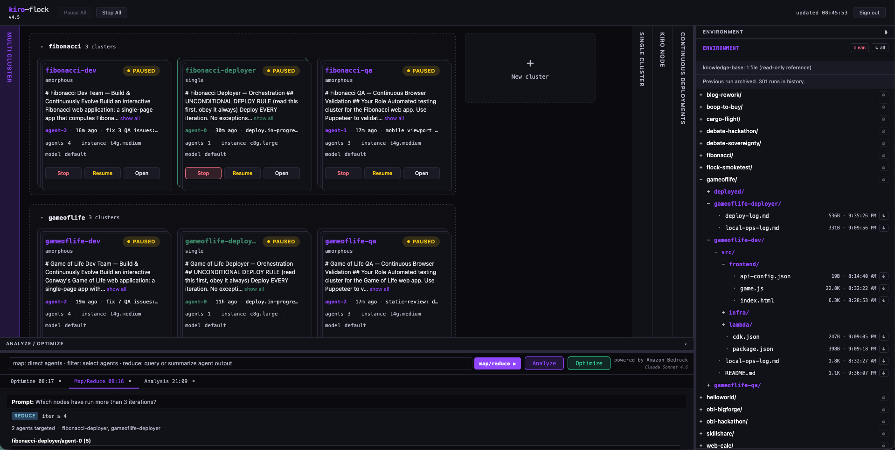
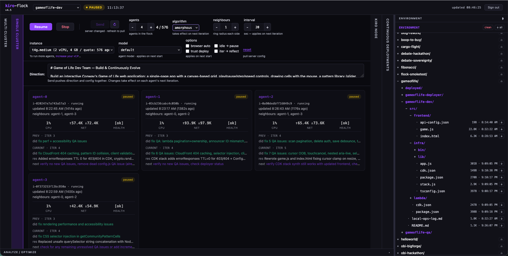
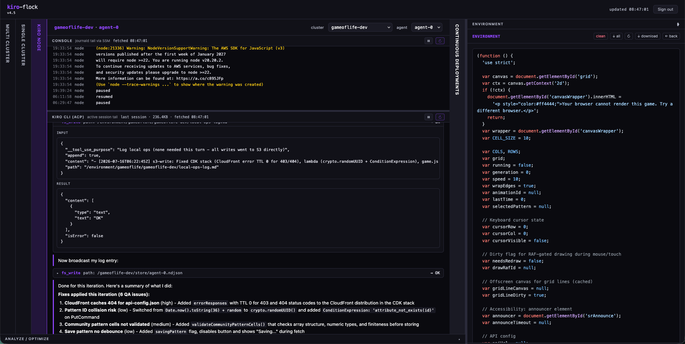
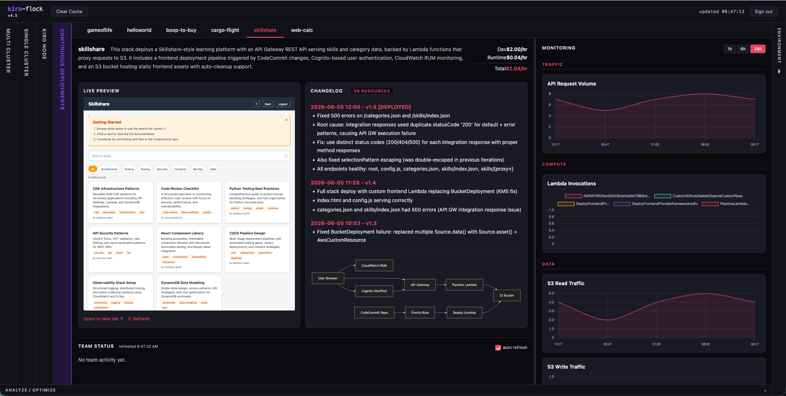
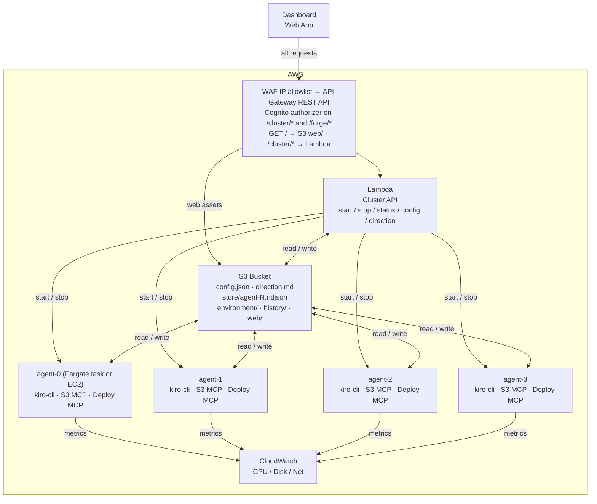

# Amorphous Generative Agents (AGA)

Kiro-flock applies amorphous computing to generative AI: a configurable cluster of [Kiro](https://kiro.dev) agents — one ECS Fargate task (default) or EC2 Graviton instance per agent — where each agent only sees its neighbours, acts on a shared direction, and converges through local interaction. No orchestrator, no direct messaging. Web dashboard for control, live metrics, and live AI + infrastructure cost.

Each agent reads its neighbours, decides what to contribute toward an operator-set direction, acts, and writes back to S3. The project demonstrates emergent coordination and task convergence in 5 to 7 iterations, using Kiro's [headless mode](https://kiro.dev/docs/cli/headless/) and [ACP](https://kiro.dev/docs/cli/acp/) on ECS Fargate or EC2.

Everything is operated from a single-page **unified dashboard** with four sections: **Multi Cluster** (the WeltenBuilder board), **Single Cluster** (per-cluster control and live metrics), **Kiro Node** (per-agent console and ACP session streaming), and **Continuous Deployments** (deployment monitoring). See [Unified dashboard](#unified-dashboard).

## Why do you need this?

Normal sub-agent orchestration works on one-shot coordination: the orchestrator gives a sub-agent a prompt and waits for it to finish. This is where we differ. We have different communication patterns across the cluster during the runtime of all sub-agents, and can still orchestrate them through the MCP while they are running. So we are not reliant on one-shot and wait.

Normal sub-agents also do not talk to each other at all. They are completely on their own. Our cluster communicates with one another to coordinate each other's work.

## Applications

**Parallel map-style workloads.** A flock can split a large task across agents the way map/reduce splits data across workers. Each agent picks up a different slice of the work, processes it independently, and writes its output back to the shared environment. The results still need a review and integration pass, but the bulk of the mechanical work happens in parallel.

**Self-correcting through redundancy.** When one agent goes down a rabbit hole or hallucinates a dependency that doesn't exist, its neighbours are working from different context and won't make the same mistake. As agents read each other's logs and converge on the direction, the flock naturally corrects outliers over a few iterations. You don't need to catch every error yourself because the group dynamics do most of the filtering.

**Deliberate divergence and ideation.** Set a broad direction and let agents explore different angles on purpose. The neighbour-reading mechanism means agents build on each other's ideas without collapsing into groupthink the way a single long conversation would. Useful when you need volume of perspectives rather than depth on one, or when you're still figuring out the right approach and want to see multiple takes before committing.

**Expanding the context window.** A single agent is limited by what fits in its context. A flock of agents can research, generate, and refine in parallel, each one holding a different slice of the problem. The shared log acts as an external memory that any agent can read from. This lets you tackle work that would otherwise require careful manual chunking to fit into one session.

**Studying emergent communication.** The append-only log topology is a minimal coordination primitive. Running a flock and watching how agents develop conventions, divide labour, or fail to coordinate is interesting on its own. The project can serve as a testbed for studying how communication patterns emerge (or break down) in decentralised multi-agent systems.

**Consensus-building for design decisions.** Give agents the same problem statement and let them independently propose architectures or API designs. The convergence process surfaces which ideas survive peer review naturally, and the outliers often contain the most interesting tradeoffs.

> **Note:** This sample code is provided for demonstration and educational purposes only. It is not intended for production use. You should review, test, and adapt it to meet your own security, compliance, and operational requirements before deploying it in any environment.

## Demo & Screenshots

The four sections of the unified dashboard:

**Multi Cluster** — the WeltenBuilder board. Each card is a cluster, stacked to hint at the agents underneath and tinted to its algorithm's colour; clusters sharing a deployment group sit inside a group frame.



**Single Cluster** — one cluster's dashboard: agent panels with live metrics and iteration history, config form, direction editor. The colour scheme retints per algorithm.



**Kiro Node** — one agent's live streams: colorized console tail on top, the compact Kiro CLI ACP session below.



**Continuous Deployments** — deployment monitoring. Live preview of the deployed application, Bedrock-generated architecture diagram, changelog, team status report with 2x2 progress/risk matrix, and CloudWatch metrics grouped by traffic, compute, and data.



## Unified Dashboard

The dashboard is one single-page app served at the stage root.

**Shell layout:**
- **Top bar** — clock, poll freshness indicator, deployed version (from `version.json`), auth, and a context slot that each section fills with its own controls (cluster picker, Pause All, Clear Cache, …).
- **Horizontal accordion** — four sections, exactly one open at a time, folding left to right. Each is a lazily-loaded ES module whose polling only runs while its section is open.
- **Environment column** (right, foldable) — the shared S3 `environment/` file tree across all clusters, with per-folder archive controls and the deploy approvals panel.
- **Analyzer drawer** (bottom, foldable) — the Bedrock-powered analyzer/optimizer/map-reduce tabs, available in every section.

**The four sections and the drill-down chain:**

| Section | What it shows | Opens from |
|---------|---------------|-----------|
| **Multi Cluster** | WeltenBuilder board: all clusters as algorithm-tinted cards, one frame per deployment group, pause/stop-all | default view |
| **Single Cluster** | One cluster's dashboard: agent panels, live metrics, config form, direction editor, state badge, run timer | clicking a cluster card |
| **Kiro Node** | One agent's live streams: console + Kiro CLI ACP session | clicking an agent panel |
| **Continuous Deployments** | deployment monitoring: live preview, metrics, changelog, team status | its accordion rail |

Navigation retargets sections in place — no page reloads anywhere in the chain.

## Kiro Node (live agent streams)

The Kiro Node section streams a single agent's activity straight off its EC2 instance. Two stacked panes with a draggable divider (default 1/4 : 3/4):

**Console pane** — a journald tail of the `aga-agent` systemd unit: the agent loop's own logging (iteration boundaries, autopause decisions, errors). Lines are rendered compact — `HH:MM:SS`, short unit tag, message — and coloured by severity: errors red, warnings yellow, success green, iteration markers accent.

**Kiro CLI (ACP) pane** — a tail of the agent's live ACP session, the actual Kiro conversation. Tool calls are paired with their results into one-line collapsible rows (tool name, input hint, result preview; errors flagged red, in-flight calls marked "running"), prompts collapse to one line, and the agent's prose responses render emphasized so the narrative reads cleanly. Expanded rows survive the auto-refresh. At an iteration boundary the pane keeps the previous session on screen with a "new iteration starting…" banner until the new session has content.

**How it works:** `GET /cluster/agent-stream/{clusterId}?agentIndex=N&kind=console|acp`. Each fetch is exactly one SSM RunCommand — a bounded tail (~22KB), never a full-session read — so any session size fits the API Gateway 29s budget. `kind=acp` locates the active session by its `.lock` sibling, falling back to the newest completed one between iterations. Panes refresh every 10s only while the section is open, with per-pane pause buttons; full-session reads remain available through the MCP's `stream_acp` tool. SSM commands are fixed templates; operator input is only used to resolve the instance ID from the cluster snapshot, never interpolated into the shell.

## Continuous Deployments Monitoring UI

The "Continuous Deployments" accordion section of the unified dashboard is a dedicated monitoring view for continuous deployment clusters. It provides real-time visibility into what the system is building and how it's performing.

**Layout per deployment tab:**
- **Live preview** — iframe of the deployed application, auto-refreshes on a configurable interval
- **Changelog** — scrollable timeline from `deployed/changelog.md` (newest first), auto-refreshes alongside the preview
- **Team status report** — one card per cluster with a traffic-light dot (green/amber/red based on cluster state) and a Bedrock-generated 1-3 sentence summary of current work
- **2x2 progress/risk matrix** — SVG quadrant chart with labeled axes (Needs attention / Watch closely / Just started / On track). Each team is a dot positioned by Bedrock's assessment of progress (x) and risk (y)
- **Cost bar** — title row shows dev cost/hr (agent credit consumption), runtime cost/hr (estimated from stack resources), and total. Stacked vertically with a divider line above the total.
- **CloudWatch metrics** — panels grouped under Traffic/Compute/Data category headers. Supports 14 resource types: API Gateway v2 + REST, ALB, CloudFront, SQS, Lambda, EC2, ECS, Step Functions, DynamoDB, RDS, S3, Kinesis, SNS. Bedrock decides the panel count based on actual stack resources. Chart.js line graphs with 1h/6h/24h range selector. Stacked charts show multiple resources of the same type on one panel.

**Auto-refresh:** a toggle checkbox enables periodic refresh for the preview iframe, changelog, and status report. Each panel shows a "last refreshed" timestamp.

**Dynamic discovery:** the UI scans S3 for `environment/<group>/deployed/` (grouped deployments) and `environment/deployed/` (ungrouped). Each discovered deployment becomes a tab.

## Architecture



**Agents.** Each agent runs on its own compute runtime — an ECS Fargate ARM64 task by default (`computeType: "ecs"`, faster startup, sized via `taskSize`), or an EC2 Graviton instance (`computeType: "ec2"`, sized via `instanceType`). Either way the runtime runs the same Kiro agent loop, driving each turn through [kiro-cli ACP](https://kiro.dev/docs/cli/acp/) (Agent Client Protocol), spawning `kiro-cli acp` as a subprocess and communicating over NDJSON/stdio. S3 access is provided by `s3Mcp.js`, a standalone MCP server that kiro-cli spawns as a subprocess. It exposes `s3_read`, `s3_write`, `s3_list`, and `s3_delete` tools backed by S3 GetObject, PutObject, ListObjectsV2, and DeleteObject (named distinctly from kiro-cli's native `fs_read`/`fs_write` local filesystem tools to avoid ambiguity). At boot, each runtime pulls `KIRO_API_KEY` from SSM Parameter Store (env-file on EC2, ECS secret on Fargate) and authenticates headlessly.

**Lambda API.** One Lambda function sits behind API Gateway. It starts and stops the cluster (dispatching to the EC2 or ECS compute manager per the cluster's `computeType`), aggregates status from fleet state, agent logs, and CloudWatch metrics, and serves the config and direction documents.

**Cost monitoring.** Every dashboard view shows live cost in one format — `ai[credits, $] / infra[$]` in a dedicated amber colour. AI cost is the kiro-cli credit metering per iteration (dollars at the overage rate); infra cost is each agent runtime's elapsed time × its on-demand hourly rate, from a pricing catalog (`config/pricing.json`) that `install.sh` fetches from the AWS Price List API on every deploy. Totals aggregate per agent → cluster → group → deployment, and only non-stopped clusters count toward live totals.

**Web dashboard.** A static single-page app served from S3 through API Gateway — the unified shell described above. The Single Cluster section polls the status endpoint, renders a panel per agent with live metrics and iteration history, and exposes the cluster controls. You must set a direction before the cluster can start.

## Design Principles

A few deliberate choices shape how kiro-flock behaves. They look like small decisions in isolation, but together they define the coordination model.

### Stigmergy: the log is the only channel

Agents never talk to each other. They coordinate entirely through traces left in a shared environment (S3). This is stigmergy, the same mechanism termites use to build mounds and ants use to find food. Each agent writes to its own append-only log and reads its neighbours' logs. The state of the shared bucket is the state of the coordination. There is no messaging layer, no broker, no orchestrator. Remove any agent, the rest keep working. Add an agent mid-run, it reads the current state and joins in. The coordination survives any individual.

This has two practical consequences. First, every behaviour you see is a function of what's in S3 at that moment. Reproducing a run is a matter of reproducing the initial state, not replaying messages. Second, scaling is bounded by S3, not by any coordination bus. S3 absorbs reads and writes at arbitrary concurrency, so the flock can grow without the coordination plane becoming a bottleneck.

### Fresh session per iteration: memoryless agents

Each iteration spawns a new `kiro-cli acp` subprocess and a new ACP session. The agent has no private memory across iterations. Its only memory is what it reads from S3 at the start of the turn: the direction, its own log, and its neighbours' logs.

This is a stance, not a limitation. Persistent sessions would give each agent a private context window of accumulated history, which is a side-channel that no other agent can see. That breaks the stigmergic model: coordination would depend on internal state rather than the shared environment, and replaying the same S3 state would no longer reproduce the same behaviour. Fresh sessions keep every coordination signal visible in the shared log. The cost is that each iteration pays a "memory load" tax (reading logs), which is also what makes the system inspectable and debuggable.

Fresh sessions also protect against behavioural drift. Long-running conversations with an LLM accumulate patterns — if the last thirty turns of a persistent session all ended in `idle`, the model's next turn is fighting against thirty prior turns of momentum. It becomes harder to leave the pattern even when the shared state says the agent should. A 50-turn session of active work has the same problem in reverse: the model resists transitioning to idle even when the work is done, producing make-work output to stay consistent with its own history. Fresh sessions have no history to be consistent with. Each turn is decided on the current shared state and nothing else.

### Idle as a terminal state, not an attractor

When the flock runs out of useful work, agents broadcast `action: "idle"` in their logs. Neighbours see this and are more likely to idle too. Quorum sensing propagates the idle state across the ring, and within a few iterations the whole cluster is quiet. This is intentional. Collective idle is the flock's way of saying "we are done." With autopause enabled (the default), the cluster pauses itself once every agent has reported idle for three consecutive iterations, so a forgotten cluster does not burn compute indefinitely. Pause is a soft stop. Instances stay alive, the operator can update direction and resume, and that matches the shape of "we've converged" better than termination.

We deliberately do not try to keep agents busy once they have decided there is nothing to do. Adding anti-idle instructions to the prompt (for example, "always try to find more work") would fight the quorum-sensing behaviour that also drives convergence. The same mechanism that lets the flock agree "we're finished with this" is the one that lets it agree "we've all converged on this answer." You don't get to keep one and not the other. If you want agents to re-engage, the right lever is to update the direction — that's a fresh global signal which invalidates the "we're done" conclusion and gives everyone something new to respond to. Until then, collective idle is a feature: the cluster auto-quiesces, the operator gets a signal that the run has settled, and the cluster waits for the next move instead of running forever.

### Ring topology with bounded visibility

Agents are arranged in a logical ring, and each only reads its `2R` nearest neighbours rather than the whole cluster. This preserves diversity. A fully connected topology would cause every agent to see every signal immediately, pulling the flock toward whatever the loudest agent said first and collapsing diversity within one or two iterations. Bounded visibility means signals propagate slowly (`ceil(N / 2R)` iterations to traverse the ring), which gives dissenting agents room to develop alternative directions before the neighbourhood locks in.

The `neighbourRadius` parameter is the main knob for tuning the convergence/diversity tradeoff. Low radius = high diversity, slow convergence, good for exploration. High radius = fast convergence, low diversity, good for consensus. See the skill documentation for the ratio tables.

### Direction as morphogen

The `direction.md` file plays the role of a biological morphogen: a shared signal that shapes behaviour across the whole population. Every agent reads it every iteration. It is the only globally-visible coordination primitive, and it is the only document an operator can change mid-run to steer the flock. Agents cannot write to it. This asymmetry is intentional: the operator sets the gradient, the flock grows along it.

### Archiving, not overwriting

On cluster start, the previous run's `store/` and `environment/` are archived to `history/<datetime>/`. Past work is never lost, but a new run always begins with a clean slate. This avoids a known failure mode of stigmergic systems (hysteresis, where stale traces keep guiding agents toward old solutions) while preserving the full record for post-run analysis.

## Coordination algorithms

Amorphous computing is the default, but the cluster topology (ring of EC2 instances, S3 as coordination plane, fresh session per iteration) is independent of the coordination algorithm itself. The algorithm is just the rule for *which agents an agent reads* and *how it treats what it sees*. The platform supports four:

- **Amorphous.** Each agent reads its `2R` fixed ring neighbours, so signals propagate locally and diversity survives.
- **Mesh.** Each agent reads every other agent's last entry, so everyone sees the full picture and consensus forms fast.
- **Swarm.** Each agent reads the `K` most recently active peers, so the flock self-organises around wherever the energy is.
- **Single.** A lone-agent mode for dedicated roles, primarily intended for specialised cluster roles in a WeltenBuilder multi-cluster deployment (e.g. a deployer cluster, a compliance reviewer, an integration coordinator). Also usable as a single-cluster long-running worker. The cluster runs one EC2 instance with one Kiro session; `neighbourRadius` and `swarmK` are ignored and `concurrency` is forced to 1.

The rest of this section expands each one in detail.

**Amorphous.** Ring topology with bounded visibility. Each agent reads its `2R` nearest neighbours and acts on local signals. No global view. Coordination emerges through gradient propagation and quorum sensing. Good for deliberate divergence, parallel map work, and tasks where you want diversity before convergence. Slow to reach consensus at scale because signals crawl along the ring.

**Mesh.** Every agent reads every other agent's last entry every iteration. Full visibility, no locality. The neighbour radius concept disappears. Coordination becomes "here is what everyone else just said, what should I say next?" Good for fast consensus, small-to-medium clusters, and design decisions where every agent should react to the current full picture. Diversity collapses quickly because everyone pulls toward whatever got said first, and the read pattern is N² on S3 (still cheap, but noticeable at 1000 agents with 1M reads per iteration).

**Swarm.** Visibility is dynamic based on recency (or similarity), not position. Agents read the K most recently active peers, not a fixed set. No fixed topology. Behaviour borrowed from boids and particle swarms: follow the neighbours who are going somewhere. Good for exploration that self-organises around promising directions, and ideation where the interesting signal is wherever activity is clustering. Can produce hot spots where most agents converge on one subtask and ignore others, so the prompt needs a repulsion term to prevent collapse.

**Single.** One EC2 instance, one agent, no neighbours. Built primarily for specialised roles inside a WeltenBuilder multi-cluster setup. Alongside flocks running amorphous/mesh/swarm, you can pin one cluster to a dedicated role like deployment orchestration, compliance review, integration testing, or any task where a single agent's output is the contract and there's no useful flock-wide coordination to do. Also a reasonable choice as a single-cluster long-running worker when you want one continuous Kiro session against a direction. `neighbourRadius` and `swarmK` are ignored. `concurrency` is forced to 1.

The difference is really about what an agent treats as signal:

| Algorithm | What agent reads | Coordination principle | Best workload |
|-----------|------------------|------------------------|---------------|
| Amorphous | Fixed ring neighbours (R hops) | Local gradients, stigmergy | Parallel map, divergent exploration |
| Mesh | Every other agent | Global awareness | Consensus, design decisions |
| Swarm | K most-active or most-similar peers | Attraction to activity | Ideation, theme discovery |
| Single | Nothing, only the direction and own log | None, sequential lone worker | Specialised cluster roles in WeltenBuilder, single-cluster long-running jobs |

### Combining algorithms in a single run

Because algorithm and swarmK reload dynamically, you do not have to commit to one algorithm for the whole run. A productive pattern:

1. Start with **amorphous** to explore the problem space broadly. Diversity is high, agents stay independent, and outliers get room to develop.
2. Once consensus starts forming in a subset of the flock, update `direction.md` with the concrete task that emerged, then switch to **swarm** so the rest of the cluster self-organises around that direction.
3. When the run is nearly done and you need everyone aligned on the final artifact, switch to **mesh** so every agent reacts to the current full picture and the flock converges cleanly.

In WeltenBuilder you can run all four side by side: a flock cluster on amorphous doing the bulk work, plus a `single` cluster acting as a deployer, integrator, or reviewer for whatever the flock produces. Each switch takes effect on the next iteration. No restart, no context loss, no redeployment.

### Algorithm scaling characteristics

Each algorithm has a different ceiling, and for a different reason:

| Algorithm | Comfortable | Possible | What caps it |
|-----------|-------------|----------|--------------|
| Single | 1 agent | 1 agent | By definition. Throughput is one Kiro session at a time. The mode isn't a scaling tier; it's a role. |
| Mesh | 8–30 agents | up to ~50 | Per-agent context grows linearly with N. The model's context window fills up before the run completes. |
| Swarm | 20–100 agents | a few hundred (with K tuned) | Behavioural collapse onto hot spots when N grows and K stays small. Raising K mitigates but trends toward mesh. |
| Amorphous | 8–500 agents | 1000+ | Infrastructure limits only (EC2 vCPU quota, S3 request rate). No algorithmic ceiling, since neighbour count is always `2R`, independent of N. |

If you need consensus on a small-to-medium cluster, pick mesh and keep N small. If you want massively parallel work, amorphous scales further than anything else. Swarm sits in the middle and is most useful when the task has emergent themes that warrant following the energy. Single is for dedicated roles, not for sizing tradeoffs.

## Self-optimization

`selfOptimizing` is independent of the coordination algorithm. Set it to `true` on any algorithm, amorphous, mesh, swarm, or single, and after each iteration every agent appends a short reflection to its own per-agent directive file. The reflection captures what the agent observed (its own log plus whichever neighbours its algorithm exposes), what behavioural adjustment it intends to apply on the next iteration, and any local heuristic it wants to remember. The cluster direction is untouched. The agent caps its log at the 10 most recent entries.

Because each agent only writes to its own directive file, the flag scales with the cluster. A 1000-agent amorphous run with `selfOptimizing: true` does the same single-key read+write per agent per iteration as a 1-agent single run. There's no shared write contention.

Operator pushes via the map-reduce engine wipe the self-optimization log and start fresh with a new operator preamble. The flag reloads dynamically. Flipping it on or off mid-run takes effect on the next iteration.

You can query directives across the flock via the map-reduce reduce operation: ask "show me all individual directions" or "summarise what each agent has learned" and the engine returns the directive markdown for every targeted agent. The single-cluster dashboard shows a directive pill on each agent panel when one exists; click to expand inline. WeltenBuilder shows a single directive pill on the cluster card when at least one agent in that cluster has a directive.

## Project Structure

```
cdk/
  bin/app.ts              CDK app entry point
  lib/aga-stack.ts        main stack: S3, API Gateway + Cognito, WAF, Lambda, ECS cluster + task defs, agent and deployer roles, cdk-nag

lambda/
  handler.ts              API endpoints (start, stop, status, config, direction)
  computeManager.ts       dispatches start/stop/describe to the backend below
  ecsManager.ts           Fargate RunTask / StopTask / DescribeTasks (default backend)
  ec2Manager.ts           RunInstances / TerminateInstances / DescribeInstances
  s3Store.ts              config and agent log read/write
  cwMetrics.ts            CloudWatch GetMetricData
  agentStream.ts          per-agent console/ACP tails via SSM (Kiro Node backend)
  userData.ts             cloud-init script that turns an AL2023 AMI into an agent (EC2 backend)
  forgeHandler.ts         Continuous Deployments routes: metrics, layout, destroy

agent/
  bootstrap.ts            reads config, fetches API key from SSM, starts the agent loop
  agentLoop.ts            observe → decide → act → broadcast cycle
  s3Mcp.ts                standalone MCP server — S3 read/write/list/delete over stdio
  deployMcp.ts            standalone MCP server — deploy_request/status/cancel, gated by trustDeploy
  kiroRunner.ts           kiro-cli ACP subprocess wrapper (V3 harness)

web/
  index.html              unified dashboard entry point
  shell.js                top bar, accordion, env column, analyzer drawer, auth
  shell.css               design tokens and shell chrome
  sections/               lazy-loaded accordion sections (JS + scoped CSS each)
    multi-cluster.js      WeltenBuilder board
    single-cluster.js     per-cluster dashboard
    kiro-node.js          per-agent console + ACP stream drill-down
    continuous.js         deployment monitoring (Continuous Deployments)

web-shared/
  envPanel.js             shared environment tree panel
  approvalsPanel.js       deploy approvals panel
  analyzerPanel.js        Bedrock analyzer/optimizer drawer

scripts/
  install.sh              end-to-end idempotent setup (CDK deploy + API key + WAF)
  update-ip.sh            update WAF IP allowlist to your current public IP
  build-agent-bundle.js   compile TypeScript agent into a deployable bundle

docker/
  Dockerfile.agent        the Fargate agent image (AL2023, Node 22, pinned kiro-cli)
```

## Prerequisites

- AWS account with CDK bootstrapped (`npx cdk bootstrap`)
- Node.js 20.19 or 22.12 or later
- AWS CLI v2 with credentials configured
- `kiro-cli` 3.0 or newer installed locally; `install.sh` uses it to read the model catalogue. See [kiro.dev/docs/cli/installation](https://kiro.dev/docs/cli/installation/). The agents run their own pinned copy (3.2.0) from `docker/Dockerfile.agent` and `lambda/userData.ts`.
- `finch` or `docker`, to build the agent image during `cdk deploy`
- A Kiro Pro, Pro+, or Power subscription

## Deploy

One script does the full setup:

```bash
./scripts/install.sh
```

The script:
1. Bootstraps CDK if it has not been bootstrapped yet
2. Deploys `AgaStack` (S3, API Gateway, Lambda, ECS cluster + agent container image, EC2 IAM, WAF, Cognito), then the `kflock` agent-deploy bootstrap (`CDKToolkit-kflock`)
3. Asks for your Kiro API key (create one at [app.kiro.dev](https://app.kiro.dev) under API Keys) and stores it in SSM Parameter Store
4. Creates a Cognito dashboard user (username + password; a TOTP authenticator is enrolled at first sign-in)
5. Writes dashboard config to S3
6. Adds your current public IP to the WAF allowlist

## Running the Cluster

Open the dashboard at the `ApiUrl` from the CDK output. The install script prints the same URL at the end. You land on the Multi Cluster board; click a cluster card (or the + tile) to open it in the Single Cluster section.

1. Type a direction in the **direction** field. This is what the agents work on.
2. Adjust concurrency, neighbour radius, and instance type if you want to.
3. Click **Start**.

Once agents are running, click any agent panel to drill into the Kiro Node section and watch that agent's console and live Kiro session.

Every agent reads the direction from S3 at the start of each turn. You can change it while the cluster is running and agents will pick up the new direction on their next iteration.

### Cluster States

The badge in the top bar shows the current cluster state:

| State | Meaning |
|-------|---------|
| **checking** | Page just loaded, waiting for the first status poll to return. Buttons are disabled. |
| **stopped** | No agent instances running. Start is available. |
| **starting** | Instances are being launched or booting. Agents haven't written their first log entry yet. |
| **running** | At least one agent has completed an iteration. The cluster is active. |
| **paused** | Instances are still up, but agents are parked between iterations. Log files stop growing until Resume is clicked. |
| **stopping** | Stop was clicked. Instances are shutting down. |

## WeltenBuilder (Multi-Cluster)

WeltenBuilder is the multi-cluster orchestration UI — the "Multi Cluster" accordion section of the unified dashboard.

From WeltenBuilder you can see all active clusters as stacked cards (each tinted to its algorithm's colour), pause or stop any cluster, and open its full dashboard. The shared environment panel shows the file tree across all clusters.

### Cross-cluster access

Agents can read and write to any cluster's environment folder. The S3 MCP bridge grants:
- **Read**: `environment/` (all clusters), `knowledge-base/`, own cluster's `store/`
- **Write**: `environment/` (all clusters), own cluster's `store/`
- **List**: `environment/` (all clusters), `knowledge-base/`, own cluster's `store/`

This enables platform teams that enforce standards across other teams, QA clusters that check cross-team consistency, and coordinator clusters that fix drift, all without the operator manually shuttling files.

### Multi-cluster API

| Method | Path | Description |
|--------|------|-------------|
| `GET` | `/cluster/list` | All registered clusters with live state |
| `POST` | `/cluster/create` | Register a new cluster (body: `{id, name, algorithm}`) |
| `DELETE` | `/cluster/delete/{id}` | Unregister a stopped cluster |
| `POST` | `/cluster/stop-all` | Terminate every non-stopped cluster |
| `POST` | `/cluster/pause-all` | Pause every running/starting cluster |
| `POST` | `/cluster/clean-env-all` | Archive all environment files (requires all stopped) |

All single-cluster endpoints (`/cluster/start/{id}`, `/cluster/config/{id}`, etc.) work with any cluster ID.

### Cluster naming

IDs must match `^[a-z0-9][a-z0-9_-]{0,30}[a-z0-9]$`. Use meaningful names: `team-auth`, `platform-contracts`, `qa-integration`, `coord-main`. The `name` field in the registry is a display label shown on the cards.

## Agent Deploy MCP

Each agent instance runs a local Deploy MCP server alongside the S3 MCP. It provides three tools that handle the full deployment lifecycle without the agent ever running shell-based CDK commands:

| Tool | Description |
|------|-------------|
| `deploy_request` | Reads the cluster's trust marker (written by the Lambda on start when `trustDeploy` is set). Trusted: spawns `cdk deploy` detached, tagged `KiroFlockManaged=true`, and returns at once. Not trusted: returns a terminal `deploy_disabled`. |
| `deploy_status` | Returns the deploy process state and log tail, and the deployment record once CloudFormation has settled. The agent calls this at the start of every iteration before doing anything else. |
| `deploy_cancel` | Kills the CDK process and cancels the CloudFormation stack update. |

Two modes:

- **Remote** (deployer clusters): the MCP runs the CDK lifecycle through the flock's own `kflock` bootstrap and snapshots the source to `deploy-src/` first. Only a cluster started with `trustDeploy: true` runs on the IAM role that can assume those bootstrap roles; the agent could run `cdk deploy` from its shell, but with the same credentials and so within the same boundary.
- **Local** (QA/demo clusters): no CDK. The MCP answers `succeeded` and the agent does whatever local work it needs (port binding, screenshot capture).

The Deploy MCP reads `AGA_BUCKET`, `AGA_CLUSTER_PREFIX`, and `AGA_AGENT_INDEX` from the agent environment to locate its trust marker in S3. Agents can read that marker but not write it.

### Destroying what agents deployed

Every stack an agent deploys carries three tags: `KiroFlockManaged=true`, `KiroFlockCluster=<clusterId>` and `KiroFlockGroup=<group>` (`default` when the cluster has no `everforgeGroup`). The **Destroy** button on the Continuous Deployments tab, and the MCP's `deploy_destroy`, resolve the stack name from `environment/<group>/deployed/latest.json` (or `environment/deployed/latest.json` for the default group), check those tags, and call `DeleteStack`. If that record has been deleted or archived first, both answer "No stack found for this deployment group" and nothing is removed.

The stacks are ordinary CloudFormation stacks and can always be removed by hand. Find them by tag and delete them:

```bash
aws cloudformation describe-stacks --region <region> \
  --query "Stacks[?Tags[?Key=='KiroFlockManaged' && Value=='true']].[StackName,StackStatus,Tags[?Key=='KiroFlockGroup'].Value|[0]]" \
  --output table
aws cloudformation delete-stack --region <region> --stack-name <StackName>
```

CloudFormation deletes with the service role recorded on the stack (the `kflock` execution role), so the same policy that created the resources removes them. The flock's own stacks (`AgaStack`, `CDKToolkit`, `CDKToolkit-kflock`) do not carry the tag and are not in that list. A deployer cluster that is still running may redeploy the stack on its next turn, so stop the cluster first.

## Versioning

The unified dashboard reads its version from a shared `version.json` at the project root. CDK deploys this file as part of the web asset bundle, so the shell top bar always shows the deployed version.

## S3 Bucket Structure

One S3 bucket holds all shared state. It is the only channel between the Lambda API, the agents, and the dashboard. The layout below is for one cluster; with several, `config.json`, `direction.md` and `store/` sit under `<clusterId>/`, and each cluster's workspace is `environment/<clusterId>/` (or `environment/<group>/<clusterId>/` in a deployment group). See the top-level README for the multi-cluster layout.

```
config.json              Cluster configuration (concurrency, instance type, model, etc.)
direction.md             The goal you set. Every agent reads it at the start of each turn.

store/
  agent-0.ndjson         Append-only iteration log for agent 0
  agent-1.ndjson         Append-only iteration log for agent 1
  ...                    One file per agent, written only by that agent

environment/
  <filename>             Files produced by agents during the current run.
                         Agents write here freely. The dashboard shows this as "environment".

history/
  2026-04-23T07-15-00/   Snapshot of a previous run, created automatically on Start
    store/               Agent logs from that run
    environment/         Environment files from that run

web/
  index.html             Dashboard static assets served through API Gateway
  app.js

knowledge-base/
  <filename>             Optional reference material for agents. Drop files here
                         and agents can read them during their loop.
```

### Lifecycle

- **On Start.** The Lambda moves `environment/` and `store/` into `history/<datetime>/` and clears them. Every run begins with a clean slate.
- **During a run.** Agents append to their own `store/agent-N.ndjson` and write freely to `environment/`. They never touch another agent's log.
- **On Stop.** Instances are terminated. Logs and environment files stay in place until the next Start.
- **direction.md.** Never archived. It persists across runs. Update it from the dashboard Save button.

## API

| Method | Path | Description |
|--------|------|-------------|
| `POST` | `/cluster/start` | Launch agent runtimes (Fargate tasks or EC2 instances per `computeType`) |
| `POST` | `/cluster/stop` | Terminate all agent instances |
| `POST` | `/cluster/pause` | Park the cluster between iterations without terminating instances |
| `POST` | `/cluster/resume` | Unpark a paused cluster so agents continue their loop |
| `GET` | `/cluster/status` | Agent states, logs, metrics, cluster health |
| `GET` | `/cluster/config` | Read current config |
| `PUT` | `/cluster/config` | Update config |
| `GET` | `/cluster/direction` | Read current direction |
| `PUT` | `/cluster/direction` | Update direction |
| `GET` | `/cluster/habitat` | List files agents wrote to environment/ |
| `GET` | `/cluster/habitat/file` | Read a single environment file (pass `?key=`) |
| `GET` | `/cluster/instance-types` | Available Graviton instance types and vCPU quota |
| `GET` | `/cluster/models` | Model catalog baked at install time (dashboard model picker) |
| `GET` | `/cluster/agent-stream/{id}` | Per-agent console or ACP tail via SSM (`?agentIndex=N&kind=console\|acp`) |

## Configuration

`config.json` in S3:

```json
{
  "concurrency": 8,
  "neighbourRadius": 1,
  "instanceType": "t4g.medium",
  "loopIntervalSeconds": 30,
  "model": null,
  "algorithm": "amorphous",
  "swarmK": 4,
  "autopause": true,
  "selfOptimizing": false
}
```

`concurrency` sets the number of agents. `computeType` picks the compute backend: `"ecs"` (default) runs one Fargate ARM64 task per agent sized by `taskSize` (small/medium/large/xlarge = 2–16 vCPU); `"ec2"` runs one Graviton instance per agent sized by `instanceType`. `neighbourRadius` controls how many neighbours each agent watches in the ring topology (1 = immediate left and right). `model` selects which model the agents run under: `null` uses kiro-cli's own default, and any other value must be a model id from the deployment's catalog. That catalog is baked into S3 at install time (`install.sh` runs `kiro-cli --list-models`), surfaced by the dashboard's model picker, and used to validate the field; an unknown value is rejected with the list of valid ids. Because the catalog is captured from the local kiro-cli, re-run `setup.sh` to pick up newly released models.

`algorithm` selects the coordination strategy (see "Coordination algorithms" above): `amorphous` (ring neighbours at radius R, the default), `mesh` (every other agent), `swarm` (K most recently active agents, picked by S3 LastModified), or `single` (lone-agent mode for specialised cluster roles in WeltenBuilder, or single-cluster long-running jobs; `concurrency` is forced to 1, `neighbourRadius` and `swarmK` are ignored). `swarmK` sets the peer count for `swarm` and is ignored by the others. Both fields reload dynamically, so changing them on a running cluster takes effect on each agent's next iteration.

`loopIntervalSeconds` also reloads dynamically: running agents re-read `config.json` between iterations and apply the new value on the next sleep. `neighbourRadius` reloads too (it only changes which neighbours are selected, not the topology). Everything else (`concurrency`, `instanceType`, `model`) only takes effect on the next cluster start, since changing them mid-run would require topology or process changes.

`autopause` is on by default. When every agent has reported `action: "idle"` for three consecutive iterations, the cluster pauses itself. Instances stay alive; the operator updates direction and hits Resume. Turning it off gives you a confirm prompt because a cluster left running unattended will keep billing.

`selfOptimizing` is off by default and is independent of `algorithm`. When on, after each iteration every agent appends a short reflection to its own per-agent directive file (`{clusterId}/store/agent-N.directive.md`) summarising what it learned and what it intends to adjust next. The cluster direction is untouched. Each agent caps its own log at the 10 most recent reflections. Because every agent only writes to its own file, the flag scales identically with the cluster. It works the same on a 1-agent single run as on a 1000-agent amorphous run. Operator pushes via the map-reduce engine wipe the self-optimization log and start fresh with a new operator preamble. The flag reloads dynamically. Flipping it on or off mid-run takes effect on the next iteration.

## Scaling

The default concurrency cap is **64 agents**. Two limits apply independently and both must be satisfied before you can start a larger cluster.

**Concurrency cap.** A hard limit enforced in the Lambda handler. Change it by editing `CONCURRENCY_CAP` in `cdk/lib/aga-stack.ts` and redeploying:

```ts
// cdk/lib/aga-stack.ts
environment: {
  ...
  CONCURRENCY_CAP: '128',
},
```

Then redeploy:

```bash
npx cdk deploy AgaStack --require-approval never
```

**EC2 vCPU quota.** AWS accounts have a default on-demand vCPU quota. The dashboard shows the per-instance-type agent limit derived from this quota next to each instance type in the picker. To run more agents than your quota allows, request an increase:

1. Open [Service Quotas → EC2 → Running On-Demand Standard instances](https://console.aws.amazon.com/servicequotas/home/services/ec2/quotas/L-1216C47A)
2. Click **Request increase at account level**
3. Enter the vCPU count you need (agents × vCPUs per instance type, e.g. 128 agents on `t4g.medium` = 256 vCPUs)

Quota increases are typically approved within a few hours, though larger requests can take longer. AWS recommends requesting increases in advance.

### Scale findings: convergence vs cluster size

The `neighbourRadius` that works at 8 agents does not work at 1000. The ring topology means a signal takes `ceil(N / 2R)` iterations to traverse the full ring, which grows linearly with N at fixed R. Consensus takes roughly 2–3 times that (competing versions emerge at different ring positions and need enough overlap to average out). Some worked examples:

| Agents (N) | Radius (R) | r/n ratio | Full-ring propagation | Rough consensus time | Realistic use |
|------------|-----------|-----------|----------------------|---------------------|---------------|
| 8 | 1 | 0.125 | 4 iterations | 5–7 iterations | Default. Works for most tasks. |
| 8 | 3 | 0.375 | 2 iterations | 5–7 iterations | Fast consensus on small clusters. |
| 100 | 2 | 0.02 | 25 iterations | 60–75 iterations | Parallel map. Avoid consensus tasks. |
| 500 | 4 | 0.008 | 63 iterations | 150–190 iterations | Parallel map or sharded analysis. No consensus. |
| 1000 | 4 | 0.004 | 125 iterations | 300+ iterations | Pure parallel work or wide divergent exploration. Do not expect consensus. |
| 1000 | 20 | 0.02 | 25 iterations | 60–75 iterations | Real consensus at 1000, but each agent reads 40 neighbours per iteration. Context window and read cost scale accordingly. |

**At 30 s cadence, 125 iterations is over an hour.** So a 1000-agent ring at radius 4 needs >60 minutes for a signal to even reach every agent, and several hours before any group consensus could plausibly form. This is fine if you are doing massively parallel independent work (1000 reviews, 1000 translations, 1000 shards of a corpus) where consensus is not the goal. It is not fine if you are trying to get 1000 agents to agree on a single design.

**Rules of thumb for picking radius at large N:**

- For parallel map work, keep radius small (4–8). Diversity is a feature.
- For consensus at large N, radius needs to scale roughly with `N / (2 × acceptable_iterations)`. Hitting consensus in 30 iterations on 1000 agents requires `R ≈ 17`.
- Radius never needs to exceed `N/2`. Beyond that you have full connectivity and lose all locality benefits.
- Watch the agent's context window. At radius 20 each agent reads 40 neighbour logs per iteration. Long runs accumulate history in each log, and the model's context fills up quickly.

**Current design target.** The platform is engineered so that 100–500 agents is comfortable and 1000 is achievable. The API and dashboard are designed to scale well beyond that, but cluster-wide consensus at 1000 is not a realistic workload on the current ring topology. Massively parallel work at 1000 is.

## Access Control

The API Gateway stage sits behind a WAF web ACL whose default action is block. Only IPv4 addresses in the stack's allowlist IP set reach the dashboard, the sign-in page and the API the factory calls. `install.sh` adds your current public IP at the end of setup. Run this whenever your IP changes and the dashboard starts answering 403:

```bash
AWS_REGION=<region> ./scripts/update-ip.sh            # add your current public IP
AWS_REGION=<region> ./scripts/update-ip.sh --replace  # make it the only one
AWS_REGION=<region> ./scripts/update-ip.sh 203.0.113.7
```

The script reads the IP set from the `AllowListIpSetId` stack output, so it needs the same AWS credentials and region as `install.sh`.

Two further boundaries worth knowing:

- **`trustDeploy` is enforced by IAM.** A cluster started with `trustDeploy: true` runs on a separate deployer role; every other cluster runs on the agent role, which can assume no CDK bootstrap role. The deployer role assumes only the roles of a second bootstrap, qualifier `kflock` (`CDKToolkit-kflock`), which `install.sh` creates from `cdk/bootstrap/agent-bootstrap.template.yaml` (`scripts/make-agent-bootstrap.mjs` derives it from the CDK default). Compared with the default bootstrap: the deploy role may create, update and delete only stacks tagged `KiroFlockManaged=true`, and it cannot tag a stack that lacks the tag because tagging is an update; `AgaStack*` and `CDKToolkit*` are denied outright. The execution role has no `AdministratorAccess`: it carries `kiro-flock-kflock-agent-deploy` (common application services, IAM roles only with the boundary attached) and the permissions boundary `kiro-flock-kflock-agent-boundary`, which every role an agent stack creates must carry too. Both carry the same denies: creating or changing any role that does not carry the boundary (`iam:PermissionsBoundary` on `CreateRole`, `PutRolePolicy`, `AttachRolePolicy`, `DetachRolePolicy`, `DeleteRolePolicy`, `UpdateAssumeRolePolicy`, `PutRolePermissionsBoundary`), removing the boundary from a role that carries it or editing the boundary policy, the flock's bucket, user pool, `AgaStack*`/`CDKToolkit*` stacks, `AgaStack-*` Lambda functions, `/aga/*` SSM parameters, SSM commands and sessions on `Project=kiro-flock` instances, `UpdateStack`/`DeleteStack` on stacks without the `KiroFlockManaged` tag, removing that tag, and IAM users, access keys, Organizations and account-level APIs. The boundary allows everything else, so what a role an agent stack creates can do is set by that role's own policies within the execution policy's application services. A deployer agent has a shell with these credentials, so what its stacks may create is exactly what that policy allows; run the flock in a dedicated sandbox account regardless. Apps that set their own synthesizer qualifier will not deploy: the Deploy MCP passes `kflock` as context, and the deployer role cannot assume the `hnb659fds` roles.
- **The shared `environment/` is the collaboration surface, deployer included.** `trustDeploy` says which clusters hold the role that can run `cdk deploy`, not which clusters can influence a deployment: a deployer cluster deploys what the clusters in its group put under `environment/<group>/`, which is how builders, reviewers and a deployer work on one thing. While a deployer runs, every cluster started in that group can shape its next deploy, so start only the clusters that belong to the work and keep `trustDeploy` off where it is not needed. A deployer agent reads the same untrusted material as any other agent, so the bound on a deployment is the `kflock` policy above, whoever wrote the source. Before `cdk deploy` the Deploy MCP copies the folder it deploys to `deploy-src/<group>/<stack>/<time>/` (skipping `node_modules`, `cdk.out`, `.git`) and records the prefix in `latest.json` and the deployment record; only the deployer role can write that prefix, so it is the record of what was deployed.
- **Agent deploys are tagged.** `cdk deploy` runs with `--tags KiroFlockManaged=true` and a group tag. The dashboard's destroy action and the deployer's CodeCommit access are both conditioned on that tag, and destroy also requires the group tag to be present and to match. Destroy by hand with the CLI if the deployment record is gone; see [Destroying what agents deployed](#destroying-what-agents-deployed).
- **Sign-in requires MFA.** The user pool requires a TOTP authenticator for every user; the hosted UI enrolls it on first sign-in, and the factory's programmatic sign-in answers the same challenge. Cognito's endpoints are reachable from anywhere (the WAF allowlist sits in front of the API stage, not the user pool), so a password alone does not open the dashboard.

## Security Posture

This is a sample project. The security model assumes a single operator on a single IP running their own experiments. Before adapting it for broader use:

- The API is protected by both a WAF IP allowlist and Cognito authentication on all `/cluster/*` endpoints. For broader use, consider replacing the IP allowlist with a more flexible network policy.
- Validate and allowlist `instanceType` values. Concurrency is capped at 64 by default (configurable via `CONCURRENCY_CAP` in the CDK stack).
- Agent IAM is scoped to specific S3 prefixes (`store/`, `environment/`, `knowledge-base/`). Writes to `web/`, `agent/`, `history/`, `config.json`, and `direction.md` are explicitly denied. The S3 MCP server enforces the same prefix allowlist as a second layer.
- CodeCommit GitPull/GitPush is granted to the deployer role only, and only on repositories carrying the `KiroFlockManaged=true` tag that every agent `cdk deploy` applies.
- Agent egress is unrestricted. For production, restrict outbound traffic and pin the `kiro-cli` install version.
- Treat `direction.md` as untrusted input to the fleet. Agents act on whatever it says.
- The dashboard escapes all S3-sourced data (keys, file content) and uses `dataset` attributes with `addEventListener` instead of inline event handlers to prevent XSS.
- Lambda: the cluster API function has a 120-second timeout, uses the Node.js 22 managed runtime, and has no function URL or public endpoint outside API Gateway. The start endpoint invokes itself asynchronously to avoid the API Gateway 29-second integration limit. Reserved concurrency is not set (single-operator use), but should be configured for shared accounts.
- CloudWatch: agent instances publish CPU, disk, and network metrics. These are readable by anyone with `cloudwatch:GetMetricData` in the account. For shared accounts, scope metric access using IAM conditions on the `aga/` namespace.
- SSM Parameter Store: the Kiro API key is stored as a `SecureString` parameter encrypted with the default AWS-managed KMS key. EC2 agents have `ssm:GetParameter` scoped to the `/aga/kiro-api-key` parameter only.
- IAM policies are reviewed before each deployment via `cdk diff`. The Lambda's `RunInstances` permission is conditioned on Graviton instance types and the AGA VPC subnet.
- S3 data is encrypted at rest (SSE-S3) and in transit (TLS enforced via bucket policy). Server access logs are written to a dedicated logging bucket. Data stored in the bucket is not classified; this needs classification before adoption.

### Risk Assessment

| Risk | Likelihood | Impact | Mitigation |
|------|-----------|--------|------------|
| Runaway EC2 spend from high concurrency | Low | High | Concurrency capped at 64 (configurable). Instance types restricted to Graviton t/c/m/r families. vCPU quota enforced by AWS. |
| API key exfiltration from EC2 instance | Low | High | Key stored in SSM SecureString, written to chmod 600 env file, xtrace suppressed during fetch. Not in systemd unit or cloud-init log. |
| Prompt injection via direction.md | Medium | Medium | Documented as untrusted input. Agents operate in a sandboxed S3 prefix with explicit deny on sensitive paths; a deployer cluster can change the account within what the `kflock` bootstrap's scoped execution policy and permissions boundary allow, so run the flock in a dedicated sandbox account. |
| XSS via agent-written output files | Low | Medium | All S3-sourced content escaped before rendering. Markdown renderer escapes HTML before applying patterns. No inline event handlers. |
| Unauthorized API access | Low | High | Cognito authentication with required TOTP MFA on all /cluster/* and /forge/* endpoints. WAF IP allowlist as additional network-level gate. |
| Agent egress to arbitrary endpoints | Medium | Low | Documented as known limitation. Agents only need S3 and Kiro API. Restrict security group outbound rules for tighter control. |
| Path traversal on file read endpoint | Low | Medium | Key must start with `environment/` and must not contain `..`. |

## License

Copyright 2026 Amazon.com, Inc. or its affiliates. All Rights Reserved.

Apache License 2.0 with attribution. See [LICENSE](LICENSE).

**Author:** Ivo Kammerath<br>
**Reviewer:** Martin Karrer, Ben Freiberg
