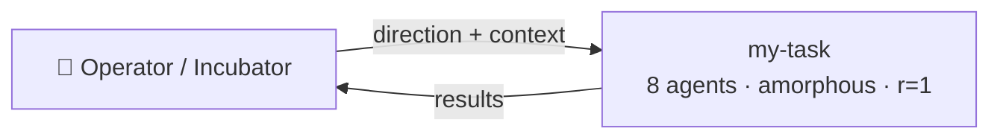
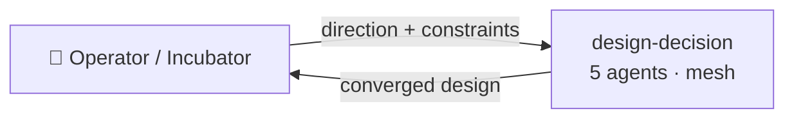
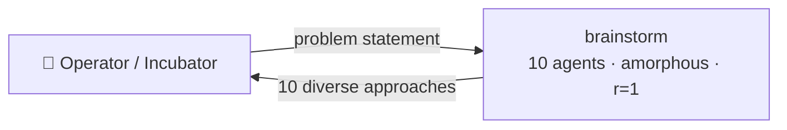
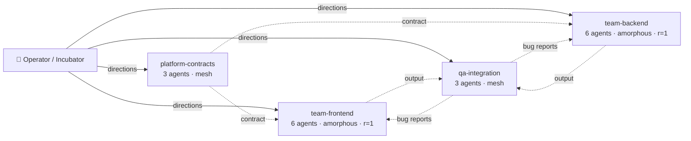
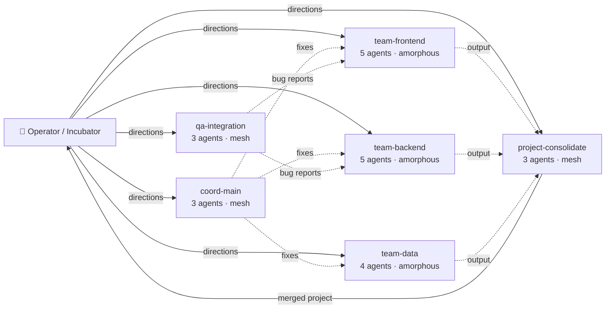
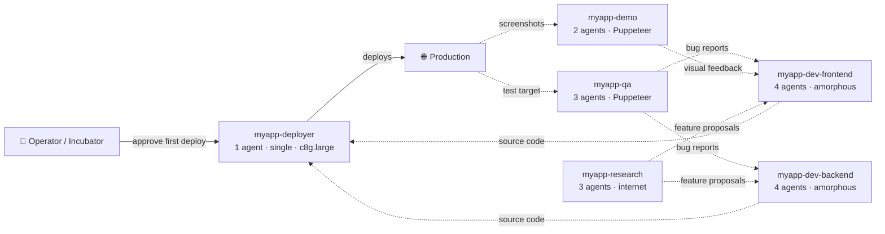
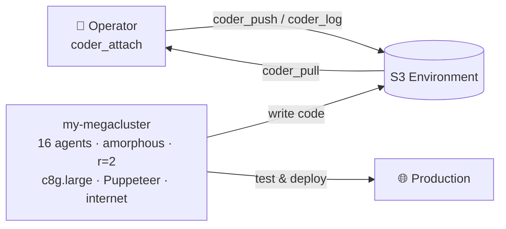
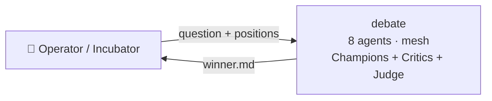
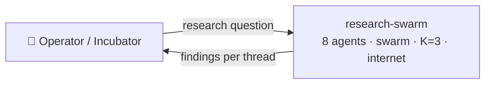
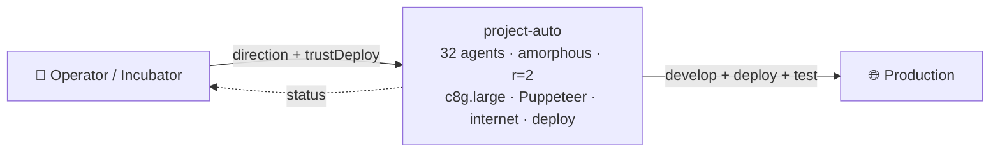

# How to Use Kiro-Flock: Topology Guide

This guide shows common kiro-flock deployment topologies. Each section shows the cluster layout as a Mermaid diagram, describes what it's for, and provides a prompt you can use to get Kiro to set it up for you.

---

## 1. Single Cluster (Parallel Map)

The simplest topology. One cluster of agents works on a parallelizable task. Each agent takes a slice of the work, observes neighbours to avoid duplication, and writes results to S3.



### Description

A ring of 8 agents with radius 1. Each agent sees 2 neighbours. Work distributes like a gradient along the ring. Best for tasks that decompose into independent chunks: reviewing files, generating test cases, processing data, writing documentation sections.

The operator uploads context, sets a direction, starts the cluster, waits for convergence, then reads the results.

### Prompt

```
I need to review these 8 API endpoint files for security issues. Set up a kiro-flock
cluster with 8 agents, radius 1, amorphous algorithm. Upload the files from ./api-endpoints/
as context. Direction: "Review each file for security vulnerabilities. Write findings to
environment/review-{filename}.md. Check neighbours to avoid reviewing the same file."
Start it and let me know when it converges.
```

---

## 2. Single Cluster (Consensus)

One cluster where agents converge on a single agreed-upon answer. Uses mesh algorithm so every agent sees every other agent's output.



### Description

5 agents, mesh algorithm (full visibility). Every agent reads every other agent's last log entry. They debate, propose, compare, and converge on a single design within 5-7 iterations. Best for architecture decisions, API design, naming conventions, or any task where you want one answer that multiple perspectives have vetted.

### Prompt

```
I need a consensus decision on our API authentication strategy. Set up a mesh cluster
with 5 agents. Upload ./requirements.md as context. Direction: "Design the authentication
strategy for this API. Consider JWT, session tokens, and OAuth2. Write your proposal to
environment/. Read all neighbours and converge on a single agreed design. When all agents
reference the same approach, write the final decision to environment/decision.md."
```

---

## 3. Single Cluster (Divergent Ideation)

One cluster optimized for generating diverse ideas. Low radius keeps agents independent so they explore different angles rather than converging.



### Description

10 agents, radius 1, amorphous. Each agent explores a unique angle. The operator stops the cluster early (after 2-3 iterations, before convergence) to capture maximum diversity. Best for brainstorming, generating alternative solutions, exploring a design space.

### Prompt

```
I want 10 different approaches to building a real-time collaboration feature. Set up
a cluster with 10 agents, radius 1. Direction: "Generate a distinct approach to real-time
collaboration for a document editor. Each agent should explore a unique angle — different
tech stacks, different architectures, different trade-offs. Do not converge. Write your
approach to environment/approach-{your-angle}.md." Stop it after 3 iterations and show
me all the approaches.
```

---

## 4. WeltenBuilder: Two-Team Split

The classic multi-cluster pattern. Two feature teams work in parallel, a contracts cluster defines the shared interface, and a QA cluster validates integration.



### Description

Four clusters launched simultaneously:
- **platform-contracts** (mesh, 3 agents): Designs the shared TypeScript types and API routes. Converges in 3-4 iterations.
- **team-frontend** (amorphous, 6 agents): Builds the UI. Reads the contract from the shared environment once it appears.
- **team-backend** (amorphous, 6 agents): Builds the API. Same contract reference.
- **qa-integration** (mesh, 3 agents): Monitors both teams. Checks that frontend API calls match backend endpoints.

All clusters share the S3 environment. Cross-cluster coordination happens through stigmergy: teams observe artifacts as they appear and self-correct.

### Prompt

```
Build a task management web app with a React frontend and Node.js API backend.
Use the WeltenBuilder pattern with 4 clusters:

1. platform-contracts (mesh, 3 agents) — designs shared types and API routes
2. team-frontend (amorphous, 6 agents, radius 1) — builds the React UI
3. team-backend (amorphous, 6 agents, radius 1) — builds the Express API
4. qa-integration (mesh, 3 agents) — validates cross-team consistency

Upload ./requirements.md to the knowledge-base. Launch all clusters simultaneously.
The contracts cluster will converge first, then teams adopt its output. QA catches
drift. Include fix loops in all directions so QA feedback triggers automatic corrections.
```

---

## 5. WeltenBuilder: Full Stack with Coordinator

A larger deployment with a dedicated coordinator cluster that monitors all teams and resolves conflicts.



### Description

Six clusters for a complex project:
- **coord-main** (mesh, 3 agents): Reads all teams' output, detects conflicts, writes resolution files.
- **team-frontend** (amorphous, 5 agents): UI layer.
- **team-backend** (amorphous, 5 agents): API layer.
- **team-data** (amorphous, 4 agents): Database schema, migrations, seed data.
- **qa-integration** (mesh, 3 agents): Cross-team consistency checks.
- **project-consolidate** (mesh, 3 agents): Merges all team output into one runnable project.

The consolidation cluster runs continuously, assembling the merged project as teams produce files. The operator downloads the consolidated output at the end.

### Prompt

```
Build an e-commerce platform with separate frontend, backend, and data teams.
Use WeltenBuilder with 6 clusters:

1. coord-main (mesh, 3 agents) — monitors all teams, resolves conflicts
2. team-frontend (amorphous, 5 agents) — React storefront
3. team-backend (amorphous, 5 agents) — Node.js API with Stripe integration
4. team-data (amorphous, 4 agents) — PostgreSQL schema, migrations, seed data
5. qa-integration (mesh, 3 agents) — validates API contract compliance
6. project-consolidate (mesh, 3 agents) — merges all output into a single monorepo

Upload ./product-spec.md and ./tech-decisions.md to the knowledge-base. All clusters
launch simultaneously. The coordinator writes resolution files to teams' environments
when conflicts arise. The consolidation cluster produces a final merged project at
environment/project-consolidate/final/. Download that when all teams converge.
```

---

## 6. Continuous Deployment: Self-Evolving Systems

The full multi-cluster continuous deployment pattern. Specialized clusters with a deployer, QA, demo, and research cluster in a continuous improvement loop. The system never stops.



### Description

Six clusters in a continuous loop:
- **myapp-deployer** (single, c8g.large, 10-15s intervals): Deploys every iteration unconditionally. The bottleneck, so it runs fast.
- **myapp-dev-frontend** (amorphous, 4 agents, 20s intervals): Builds and evolves the frontend.
- **myapp-dev-backend** (amorphous, 4 agents, 20s intervals): Builds and evolves the backend.
- **myapp-qa** (amorphous, 3 agents, Puppeteer, 30s intervals): Tests the live deployment.
- **myapp-demo** (amorphous, 2 agents, Puppeteer, 90s intervals): Screenshots and visual assessment.
- **myapp-research** (amorphous, 3 agents, internet, 60s intervals): Researches features and writes proposals.

All clusters share the deployment group `everforgeGroup: "myapp"` so paths become `environment/myapp/<cluster>/`. Any multi-cluster deployment needs this; without it the clusters would share the flat environment root with every other project. The deployer manages phase transitions (build -> integration -> evolution) and adjusts iteration speeds.

### Prompt

```
Set up a continuous deployment system for a SaaS dashboard. The project name is
"myapp". I want the full multi-cluster evolution pattern:

- Dev frontend (4 agents, amorphous, React + Tailwind)
- Dev backend (4 agents, amorphous, Node.js + DynamoDB)
- QA (3 agents, amorphous, Puppeteer browser testing)
- Deployer (single algorithm, c8g.large, fast 10s iterations, CDK deploys)
- Demo (2 agents, Puppeteer, screenshots at various viewports)
- Research (3 agents, internet access, feature proposals)

All clusters use everforgeGroup: "myapp". Autopause off on everything.
The deployer deploys every iteration unconditionally using the deploy MCP tools.
Dev teams write to S3 only (never local-only edits). QA reports bugs to dev
environments. Research writes proposals that dev teams pick up.

Upload ./initial-spec.md as context. Start everything and approve the first
deploy when it comes through. After that, the system runs autonomously.
```

---

## 7. Single-Cluster Continuous Deployment (Mega-Cluster)

The simplified alternative to section 6, previously called BigForge. One large cluster where every agent does everything: develop, test, deploy, and research. No role separation, no cross-cluster coordination. Pure stigmergy within one ring.



### Description

One cluster of 16 agents, radius 2, amorphous algorithm. Every agent follows a priority list:
1. Fix bugs (if testing found any)
2. Deploy (if code changed and no deploy is in progress)
3. Test with Puppeteer (different flow each iteration)
4. Implement features (from a long backlog)
5. Research (visit real sites, find real data)

Agents NEVER go idle. The direction explicitly forbids it. The cluster runs continuously, always improving. The operator participates using `coder_attach` to code alongside the cluster: push fixes, announce changes via `coder_log`, pull agent output.

Best for hackathons, solo operators, and time-pressure builds where multi-cluster overhead isn't worth it.

### Configuration

- **Algorithm**: amorphous
- **Concurrency**: 16 (scale 8-64 based on project size)
- **Radius**: 2 (each agent sees 4 neighbours)
- **Instance type**: c8g.large (compute-optimized, no burst throttling)
- **Browser automation**: true
- **Internet access**: true
- **Self-optimizing**: false (prevents learned shortcuts to idle)
- **Autopause**: false (the cluster never stops)

### Prompt

```
Set up a single-cluster continuous deployment for my hackathon project. One cluster
called "my-megacluster", 16 agents, amorphous algorithm, radius 2, c8g.large instances.
Browser automation and internet access both on. Self-optimizing OFF, autopause OFF.

The direction must enforce: agents NEVER idle. Every iteration they do exactly one
of: fix bugs, deploy (check deploy_status first), test with Puppeteer, implement
features, or research. The feature backlog should have 20+ items so agents always
have work.

I am the deployer — agents write code to S3, I deploy locally from .scratch/cdk-app/.
Include the live URL in the direction so agents can test against it.

Attach me to the environment with coder_attach so I can push fixes alongside the
cluster.
```

---

## 8. Adversarial Debate

A specialized topology for structured argumentation. Multiple agents champion opposing positions and debate until one side concedes or a judge declares a winner.



### Description

A mesh cluster of 6-8 agents. Each agent champions a position and argues against the others. The mesh algorithm gives full visibility, so every argument is visible to all participants. Agents concede when their position is refuted. The debate converges when remaining champions agree on a winner, or when a designated judge agent declares the outcome.

Works well for: technology evaluations, vendor comparisons, architecture trade-off analysis, any question where you want adversarial vetting of options.

### Prompt

```
I want an adversarial debate on which cloud provider is best for startups: AWS, Azure,
GCP, DigitalOcean, Vercel, or Fly.io. Set up a mesh cluster with 8 agents. Each agent
champions one provider (agents 0-5) or acts as a critic/judge (agents 6-7).

Direction: "You are debating which cloud provider is best for startups. Each agent champions
their assigned provider and argues against the others using facts: pricing tiers, free tier,
developer experience, global coverage, managed services, community support. Read all neighbours each
iteration. Concede if your position is definitively refuted. After 7 rounds, write
winner.md with the converged decision, reasoning chain, and why each competitor lost."

Let it run for 7 iterations then read winner.md.
```

---

## 9. Research Swarm

A cluster using the swarm algorithm for exploratory research. Agents follow activity hot spots, naturally gravitating toward the most productive research threads.



### Description

8 agents, swarm algorithm with K=3 (each agent reads the 3 most recently active peers). Agents naturally cluster around productive research threads. When one agent finds something interesting, its activity makes it visible to others who follow the thread. Meanwhile, agents that can't contribute to the hot spot diverge and start new threads.

Best for: open-ended research, literature review, competitive analysis, technology landscape mapping.

### Prompt

```
Research the current state of WebAssembly for server-side applications. Set up a
swarm cluster with 8 agents, swarmK=3, internet access enabled. Direction:
"Research WebAssembly for server-side use cases. Each agent explores a different angle:
runtime performance, language support, deployment patterns, production case studies,
security model, comparison to containers, edge computing use cases, developer tooling.
Write findings to environment/research-{topic}.md. Follow activity hot spots but also
explore underrepresented threads." Let it run for 5-6 iterations then collect all findings.
```

---

## 10. Autonomous Single-Cluster Deployment (Full DevOps)

The maximum-autonomy topology. One massive cluster where every agent is a full-stack DevOps engineer: they write code, deploy it, test it with Puppeteer, research the web, and loop. No operator in the deploy path. The cluster is entirely self-sufficient.



### Description

One cluster of 32 agents on large compute-optimized instances. Every agent has every capability: internet access for research, Puppeteer for browser testing, and deploy MCP tools for pushing to production. Each agent independently decides what to do on every iteration following a priority list. When an agent writes code and sees no deploy in progress, it deploys. When a deploy lands, other agents test the live URL. When tests find bugs, agents fix them and deploy the fix.

The operator's role is minimal: set the direction, set `trustDeploy: true` in the cluster config, then observe. The system runs fully autonomously from the first iteration.

This is the "big DevOps team" model: 32 engineers who all do everything, coordinating through shared visibility of what's happening (the S3 environment and neighbour logs).

### Configuration

- **Algorithm**: amorphous
- **Concurrency**: 32 (scale 16-64, each agent is a full DevOps engineer)
- **Radius**: 2 (each agent sees 4 neighbours, enough to avoid deploy collisions)
- **Instance type**: c8g.large (compute-optimized, handles CDK deploys without throttling)
- **Browser automation**: true (every agent can test with Puppeteer)
- **Internet access**: true (every agent can research)
- **Self-optimizing**: false (prevents learned shortcuts to idle or skip-deploy)
- **Autopause**: false (the cluster never stops)

### Key difference from section 7

In the single-cluster pattern of section 7, the operator deploys. Here, agents deploy themselves using the deploy MCP tools, enabled by `trustDeploy` at config time. No per-deploy approval exists, so the system ships continuously without human intervention.

Deploy collision avoidance is simple: agents call `deploy_status` before deploying. If status is "deploying", they do something else. CDK itself is also safe against concurrent deploys (CloudFormation rejects a second update while one is in progress).

### Prompt

```
Set up a fully autonomous single-cluster deployment. One cluster called "project-auto",
32 agents, amorphous algorithm, radius 2, c8g.large instances. Browser automation,
internet access, and deploy MCP all enabled. Self-optimizing OFF, autopause OFF.

Every agent is a full DevOps engineer. The direction must say:
- Agents NEVER idle
- Every iteration: fix bugs > deploy (if you wrote new code and deploy_status is
  "no_deploy" or "succeeded") > test with Puppeteer > implement features > research
- Before deploying, always check deploy_status first. If "deploying", skip and test instead.
- After successful deploy, update deployed/changelog.md and deployed/latest.json
- The live URL must be in latest.json so all agents can discover it for testing

The feature backlog should have 30+ items. Include CDK stack name and region in
the direction so agents know what to deploy.

I will approve the first deploy to grant trust. After that, the system is fully
autonomous.
```

---

## Quick Comparison

| Topology | Clusters | Best For | Complexity |
|----------|----------|----------|------------|
| Single (Parallel Map) | 1 | Batch processing, file review | Low |
| Single (Consensus) | 1 | Design decisions, architecture | Low |
| Single (Divergent) | 1 | Brainstorming, idea generation | Low |
| WeltenBuilder Two-Team | 4 | Frontend + backend split | Medium |
| WeltenBuilder Full Stack | 6 | Complex multi-domain projects | High |
| Continuous deployment (multi-cluster) | 5-7 | Continuous evolution, production apps | High |
| Continuous deployment (single cluster) | 1 | Hackathons, rapid iteration, solo ops | Low-Medium |
| Adversarial Debate | 1 | Evaluations, comparisons, decisions | Low |
| Research Swarm | 1 | Open-ended research, exploration | Low |
| Autonomous single cluster | 1 | Full DevOps, self-shipping systems | Medium |

---

## Algorithm Cheat Sheet

| Algorithm | Neighbour Rule | Best For | Max Comfortable Size |
|-----------|---------------|----------|---------------------|
| amorphous | Fixed ring (2R neighbours) | Parallel work, exploration | 500+ |
| mesh | Every other agent | Consensus, design decisions | ~30 |
| swarm | K most recently active | Ideation, following hot spots | ~100 |
| single | None (solo agent) | Deployer, reviewer, coordinator | 1 |
